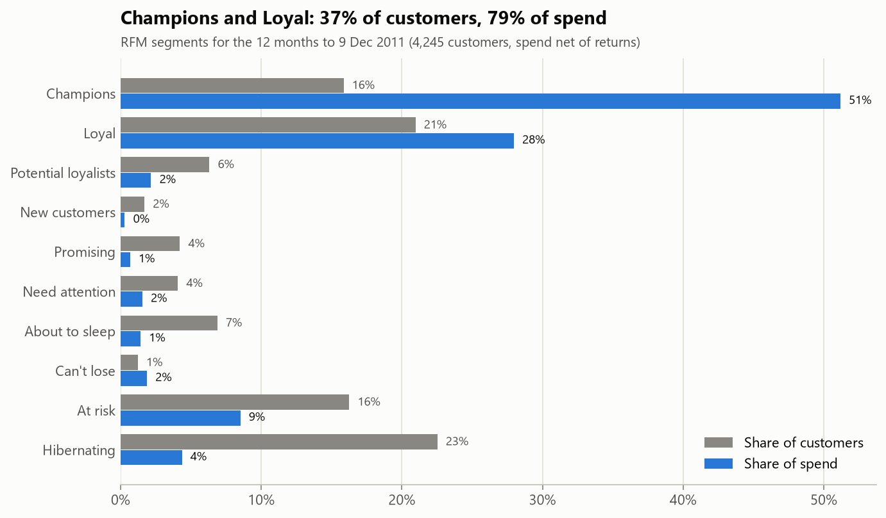
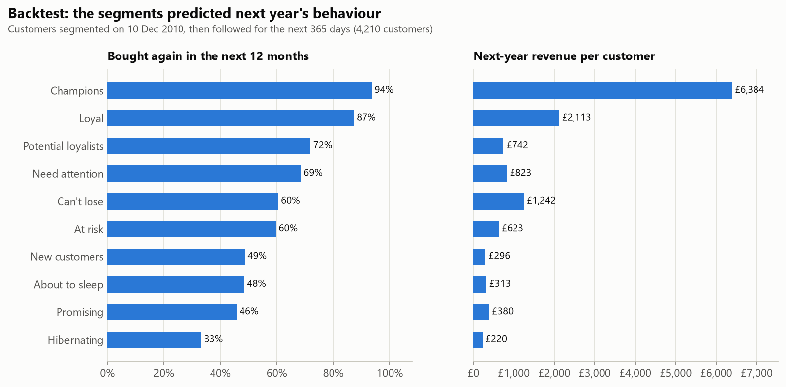
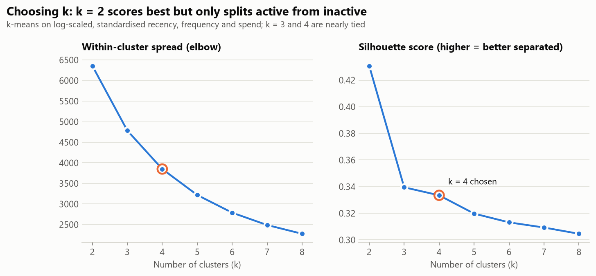
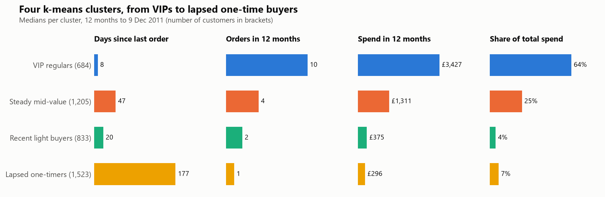

# Customer Segmentation: RFM + k-Means, Backtested

Segments the customers of a UK online gift retailer by **recency, frequency and monetary value (RFM)**, then with **k-means clustering**, and gives each segment a marketing action. Most RFM projects stop at the segment labels. This one **backtests** them: customers were segmented as of December 2010, then followed for the next 12 months to check that the segments predict who actually buys again.

Data: 1,067,371 real transaction lines, Dec 2009 to Dec 2011 ([Online Retail II, UCI](https://www.kaggle.com/datasets/mashlyn/online-retail-ii-uci)). Cleaning in **SQL (DuckDB)**, modelling in **Python (pandas, scikit-learn)**, with unit tests for both.

## Key findings

- **Spend is highly concentrated.** The top 20% of customers account for **74% of spend**. Champions and Loyal customers are 37% of the base and bring in **79%**.
- **The segments hold up a year later.** Of customers labelled Champions in December 2010, **94% bought again** in the next 12 months, spending **£6,384 each** on average. Hibernating customers: 33% and £220. The 13% of customers who were Champions produced **54% of next year's revenue**.
- **"Can't lose" customers are worth chasing.** They hadn't ordered in months, yet 60% came back and spent £1,242 each, almost twice as much as "At risk" customers (£623).
- **k-means finds the same structure with 4 groups instead of 10.** Four clusters explain as much of next year's revenue as the 10 named RFM segments (28% vs. 27% of the variance in log revenue). k-means also uses spend, which the classic RFM grid ignores. It splits the "At risk" segment into steady mid-value customers (312) and lapsed one-time buyers (378), two groups that need very different offers.



## Segments and recommended actions

Current segmentation, 12 months to 9 Dec 2011 (4,245 customers). The full customer list is in [`reports/customer_segments.csv`](reports/customer_segments.csv).

| Segment | Customers | Share of spend | Median days since last order | Action |
|---|---|---|---|---|
| **Champions** | 673 | 51.2% | 5 | Reward and protect: early access, loyalty perks, referrals. No discounts needed. |
| **Loyal** | 890 | 28.0% | 30 | Upsell and cross-sell; invite to the loyalty programme. |
| **Potential loyalists** | 268 | 2.2% | 17 | Push the next order: bundles, free-shipping threshold. |
| **New customers** | 72 | 0.3% | 8 | Onboarding emails and a second-order incentive within 30 days. |
| **Promising** | 179 | 0.7% | 24 | Introduce best-sellers; small time-limited offer. |
| **Need attention** | 173 | 1.5% | 51 | Personalised recommendations; limited-time offer. |
| **About to sleep** | 292 | 1.4% | 52 | Reactivation email with popular items; low-cost incentive. |
| **Can't lose** | 52 | 1.9% | 101 | Personal outreach from an account manager; win-back offer. Median spend £2,602, the highest of any segment. |
| **At risk** | 690 | 8.5% | 130 | Win-back campaign; survey why they stopped. Prioritise the mid-value half (see k-means). |
| **Hibernating** | 956 | 4.4% | 216 | Cheap automated reminders only; drop from paid channels if no response. |

Segment rules follow the standard RFM grid on recency score × frequency score, for example R = 5 with F = 4–5 for Champions ([`src/rfm.py`](src/rfm.py)).

## Backtest: do the segments predict the future?

Segments were assigned on **10 Dec 2010** using only the previous 12 months. Each customer was then followed for the **next 365 days**, a period the segmentation never saw.



| Segment (Dec 2010) | Customers | Bought again | Next-year revenue per customer | Share of next-year revenue |
|---|---|---|---|---|
| Champions | 549 | 94% | £6,384 | 54.1% |
| Loyal | 693 | 87% | £2,113 | 22.6% |
| Potential loyalists | 459 | 72% | £742 | 5.3% |
| Need attention | 308 | 69% | £823 | 3.9% |
| Can't lose | 86 | 60% | £1,242 | 1.6% |
| At risk | 704 | 60% | £623 | 6.8% |
| New customers | 76 | 49% | £296 | 0.3% |
| About to sleep | 262 | 48% | £313 | 1.3% |
| Promising | 179 | 46% | £380 | 1.0% |
| Hibernating | 894 | 33% | £220 | 3.0% |

Overall, 64% of customers bought again. The 10 segments explain **27%** of the variance in next-year revenue (log scale), the 4 k-means clusters **28%**, and the full set of 90 R-F-M score combinations **36%**. The named segments give up some precision in exchange for being simple enough for a marketing team to act on.

## k-means clustering

Features: recency, frequency and spend, log-transformed (8 customers spend over 100× the median customer, the largest 430×) and standardised.



- **k = 2** has the best silhouette score (0.43), but it only separates active from inactive customers, which is too coarse to act on.
- **k = 3 and k = 4** are nearly tied (0.339 vs. 0.333). I chose **k = 4** because it separates recent low spenders, who are worth nurturing, from lapsed one-time buyers, who aren't.
- **Stable:** across 10 random seeds, the cluster assignments agree almost perfectly (adjusted Rand index ≥ 0.97).



| Cluster | Customers (Dec 2011) | Bought again (Dec 2010 backtest) | Next-year revenue per customer (backtest) |
|---|---|---|---|
| VIP regulars | 684 | 95% | £6,049 |
| Steady mid-value | 1,205 | 75% | £1,195 |
| Recent light buyers | 833 | 63% | £493 |
| Lapsed one-timers | 1,523 | 39% | £222 |

How the two methods line up ([`segment_vs_cluster.csv`](reports/segment_vs_cluster.csv)): 944 of 956 Hibernating customers are Lapsed one-timers, and 496 of 673 Champions are VIP regulars. The disagreements are where k-means adds value. "At risk" splits 312 / 378 between Steady mid-value and Lapsed one-timers. 99 "Champions" ordered recently and often (median 3 orders) but spent modestly (median £641), so k-means puts them with the light buyers.

## Data cleaning (SQL)

All cleaning is in [`sql/01_clean.sql`](sql/01_clean.sql); [`reports/cleaning_log.csv`](reports/cleaning_log.csv) records each step.

| Step | Rows removed | Rows left |
|---|---|---|
| Raw export | | 1,067,371 |
| Exact duplicates | 34,335 | 1,033,036 |
| No customer ID (can't be segmented) | 235,151 | 797,885 |
| Non-product lines (postage, fees, manual adjustments, test items, vouchers) and zero prices | 3,702 | **794,183** |

- **Duplicates:** 22,844 of the 34,335 duplicate rows fall on 1–9 Dec 2010. The source workbook has one sheet per year, and the two sheets overlap that week, so it appears twice. The other 11,491 are identical lines repeated within an invoice, also removed.
- **Returns:** cancellations (invoices starting with "C") are kept as negative amounts, so spend is **net of returns**. For example, an 80,995-unit order cancelled 12 minutes later adds nothing to that customer's spend. Customers whose returns cancel all their purchases in a window are excluded.
- **RFM in SQL:** [`sql/02_rfm.sql`](sql/02_rfm.sql) computes recency, frequency (distinct non-cancelled invoices) and net spend over a 365-day window before a snapshot date. [`sql/03_next_year.sql`](sql/03_next_year.sql) computes the 365 days after it.

## Limitations

- **Scoring ties.** 35% of customers placed exactly one order, so percentile-based frequency scores give all of them F = 1, and no customer gets F = 2. This is deliberate: identical customers should get identical scores. It does leave some cells of the grid empty.
- **The backtest is descriptive, not causal.** It shows that the segments rank future value well. It does not show what any marketing action would achieve. That needs an A/B test per segment.
- **23% of sales lines have no customer ID** and can't be segmented.
- **Many customers are wholesalers.** This explains the extreme spend values; a B2B and B2C split would sharpen the segments.
- **One retailer, ending 2011.** The method transfers; the exact thresholds don't.

## How to run

Requires Python 3.11+.

```bash
pip install -r requirements.txt
```

1. Download [`online_retail_II.csv`](https://www.kaggle.com/datasets/mashlyn/online-retail-ii-uci) (95 MB) from Kaggle into `data/`.
2. Run from the project root:

```bash
python src/build.py                    # SQL cleaning + RFM tables (a few seconds)
python src/segment.py                  # scores, segments, k-means, backtest -> reports/
python src/charts.py                   # reports/figures/*.png
python -m unittest discover tests      # 11 tests, including SQL tests on a small fixture
```

## Project structure

```
├── sql/
│   ├── 01_clean.sql        # duplicates, missing IDs, non-product lines, returns
│   ├── 02_rfm.sql          # recency / frequency / net spend per customer
│   └── 03_next_year.sql    # behaviour in the following 365 days (backtest)
├── src/
│   ├── build.py            # loads the CSV into DuckDB and runs the SQL
│   ├── rfm.py              # scoring, segment rules, k-means helpers
│   ├── segment.py          # runs everything, writes reports/
│   └── charts.py
├── tests/test_pipeline.py
├── reports/                # segment tables, backtest, customer list, figures
└── data/                   # raw CSV and intermediate files (not committed)
```

## Tools

SQL (DuckDB) · Python · pandas · scikit-learn · Matplotlib · unittest
